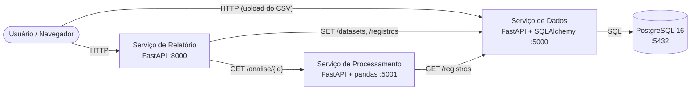

# Pipeline de Qualidade de Dados

Sistema de microsserviços que recebe datasets em CSV, avalia a qualidade dos dados (nulos, duplicatas, outliers e formatos inválidos) e gera um relatório final com score, classificação e recomendações de limpeza. Todos os serviços são containerizados com Docker e orquestrados com Docker Compose.

Atividade da disciplina (Nota 2): sistema organizado por microsserviços que se comunicam via HTTP.

## Integrantes

| Nome | RA |
|---|---|
| Nicolas Alencar | 23012092 |
| Vitor Martins | 23020961 |
| Lucas Sarzedo | 23008146 |
| Enzo Braggion | 23008519 |

## Cenário

Equipes de dados e de ciência de dados gastam muito tempo descobrindo problemas em datasets antes de treinar modelos ou construir análises. Este projeto automatiza essa etapa: o usuário envia um CSV, e o sistema devolve um relatório de qualidade com um score de 0 a 100, a análise coluna a coluna e recomendações objetivas de tratamento.

## Arquitetura



| Container | Papel | Porta |
|---|---|---|
| `db` | PostgreSQL 16 (infraestrutura de armazenamento, não é um dos microsserviços) | 5432 (interna) |
| `dados` | **Serviço de Dados**: recebe CSVs, grava no banco e expõe os registros | 5000 |
| `processamento` | **Serviço de Processamento**: consome o Serviço de Dados e calcula as métricas de qualidade | 5001 |
| `relatorio` | **Serviço de Relatório**: orquestra os outros dois e gera o relatório final | 8000 |

### Decisões de projeto

- **FastAPI**: gera documentação interativa (Swagger) automaticamente, o que facilita testes e demonstração.
- **PostgreSQL com coluna JSONB**: cada linha do CSV é guardada como JSON, então o sistema aceita datasets com qualquer conjunto de colunas, sem precisar criar uma tabela por dataset.
- **Banco isolado atrás do Serviço de Dados**: só ele acessa o PostgreSQL. Os demais serviços pedem tudo por HTTP, o que permite trocar o banco sem alterar o resto do sistema.
- **Valores guardados como texto**: o Serviço de Dados armazena os valores como vieram do CSV (campos vazios viram `null`). A inferência de tipos e a conversão ficam no Serviço de Processamento.
- **Tratamento de falhas**: chamadas HTTP entre serviços têm timeout. Se um serviço estiver fora do ar, quem o consome responde `502` com uma mensagem clara. Dataset inexistente retorna `404`.
- **Docker Compose**: sobe o banco e os três serviços com um único comando, com `healthcheck` no banco para que o Serviço de Dados só inicie quando o Postgres estiver pronto.

## Como o score é calculado

O Serviço de Processamento calcula três dimensões, cada uma de 0 a 100%:

| Dimensão | Cálculo |
|---|---|
| Completude | `1 - (total de nulos / total de células)` |
| Unicidade | `1 - (linhas duplicadas / total de linhas)`, ignorando a coluna `id` |
| Validade | `1 - (linhas com outlier ou formato inválido / total de linhas)` |

```
score = 100 * (0,4 * completude + 0,3 * unicidade + 0,3 * validade)
```

Classificação: **Excelente** (90 ou mais), **Boa** (75 a 89), **Regular** (60 a 74) e **Crítica** (abaixo de 60).

Outras regras de análise:

- **Tipo da coluna**: numérica se pelo menos 80% dos valores não nulos podem ser convertidos em número; caso contrário, texto.
- **Outliers**: método IQR (valores abaixo de `Q1 - 1,5 * IQR` ou acima de `Q3 + 1,5 * IQR`), aplicado às colunas numéricas, exceto `id`, quando há pelo menos 4 valores numéricos.
- **Formato inválido**: validação de e-mail por expressão regular nas colunas cujo nome contém "email".

## Estrutura do repositório

```
.
├── servico-dados/
│   ├── main.py
│   ├── requirements.txt
│   └── Dockerfile
├── servico-processamento/
│   ├── main.py
│   ├── requirements.txt
│   └── Dockerfile
├── servico-relatorio/
│   ├── main.py
│   ├── requirements.txt
│   └── Dockerfile
├── dados-exemplo/
│   └── clientes.csv
├── docker-compose.yml
├── .env.example
├── .gitignore
└── README.md
```

## Como executar

### Pré-requisitos

- [Git](https://git-scm.com/)
- [Docker Desktop](https://www.docker.com/products/docker-desktop/) aberto e em execução (inclui o Docker Compose)

### Passo a passo

**1. Clonar o repositório**

```bash
git clone https://github.com/NicolasAOliveira/microsservicos-pipeline-dados.git
cd microsservicos-pipeline-dados
```

**2. Criar o arquivo `.env`**

O `.env` não é versionado (está no `.gitignore`). Crie-o a partir do modelo:

```bash
# Windows (PowerShell ou CMD)
copy .env.example .env

# Linux / macOS
cp .env.example .env
```

Abra o `.env` e troque `troque_esta_senha` por qualquer senha (por exemplo, `pipeline123`):

```
DB_USER=pipeline
DB_PASSWORD=pipeline123
DB_NAME=pipeline_db
```

**3. Subir os containers**

```bash
docker compose up --build
```

Aguarde as linhas `Uvicorn running` dos três serviços. A primeira execução demora mais, pois baixa as imagens e instala as dependências.

**4. Enviar o dataset de exemplo**

O banco começa vazio, então é preciso enviar um CSV antes de gerar o relatório:

1. Abra http://localhost:5000/docs
2. Expanda `POST /datasets` e clique em **Try it out**
3. Em `arquivo`, escolha `dados-exemplo/clientes.csv` e clique em **Execute**
4. A resposta esperada é `201` com `"id": 1` e `"total_registros": 10`

**5. Gerar o relatório**

Abra no navegador (troque o `1` pelo `id` retornado no passo anterior):

- Relatório em HTML: http://localhost:8000/relatorio/1
- Relatório em JSON: http://localhost:8000/relatorio/1?formato=json
- Relatório em CSV (baixa um arquivo): http://localhost:8000/relatorio/1?formato=csv

**6. Parar os containers**

```bash
docker compose down        # mantém os dados do banco
docker compose down -v     # apaga também o volume do banco
```

### Endereços

| Serviço | Documentação interativa |
|---|---|
| Dados | http://localhost:5000/docs |
| Processamento | http://localhost:5001/docs |
| Relatório | http://localhost:8000/docs |

> Se uma das portas (5000, 5001 ou 8000) já estiver em uso na sua máquina, o Docker informará o erro. Libere a porta ou altere o mapeamento em `docker-compose.yml`.

## Endpoints

### Serviço de Dados (porta 5000)

| Método | Rota | Descrição |
|---|---|---|
| GET | `/health` | Verifica se o serviço está no ar |
| POST | `/datasets` | Recebe um arquivo `.csv` (multipart) e grava os registros |
| GET | `/datasets` | Lista os datasets com a quantidade de registros |
| GET | `/datasets/{id}/registros` | Devolve os registros do dataset (parâmetros `limit` e `offset`) |

### Serviço de Processamento (porta 5001)

| Método | Rota | Descrição |
|---|---|---|
| GET | `/health` | Verifica se o serviço está no ar |
| GET | `/analise/{id}` | Busca os registros no Serviço de Dados e devolve a análise de qualidade e o score |

### Serviço de Relatório (porta 8000)

| Método | Rota | Descrição |
|---|---|---|
| GET | `/health` | Verifica se o serviço está no ar |
| GET | `/relatorio/{id}?formato=html\|json\|csv` | Orquestra Dados e Processamento e gera o relatório final |

## Resultado esperado com o dataset de exemplo

O arquivo `dados-exemplo/clientes.csv` foi construído com problemas de qualidade conhecidos:

| Problema | Onde |
|---|---|
| Valores nulos | `idade`, `email` e `cidade` (1 cada) |
| Linha duplicada | Bruno Lima (ids 2 e 6) |
| Outlier | `idade` = 230 e `salario` = 98000 |
| Formato inválido | e-mail `diego@email` |

Resultado: completude 95%, unicidade 90%, validade 70%, **score 86,0 (Boa)**.

## Testes de tolerância a falhas

Com o sistema no ar, em outro terminal:

```bash
docker compose stop processamento
```

Ao abrir o relatório, o Serviço de Relatório responde `502` informando que o serviço está indisponível. Para restaurar:

```bash
docker compose start processamento
```

Pedir um dataset que não existe (por exemplo, `/relatorio/999`) retorna `404 Dataset não encontrado`.

## Fluxo de trabalho com Git

- A branch `main` contém sempre a versão funcional do sistema.
- Cada tarefa é desenvolvida em uma branch própria (`feat/nome-da-tarefa`) e integrada à `main` por Pull Request.
- Commits seguem o padrão de prefixos: `feat:`, `fix:`, `docs:` e `chore:`.

```bash
git pull
git checkout -b feat/nome-da-tarefa
# ...alterações...
git add .
git commit -m "feat: descrição da alteração"
git push -u origin feat/nome-da-tarefa
```

## Limitações e melhorias futuras

- Os pesos do score (40% completude, 30% unicidade, 30% validade) são fixos.
- A validação de formato cobre apenas colunas de e-mail; poderia ser estendida para CPF, telefone e datas.
- Não há autenticação nem fila de mensagens entre os serviços.
- O dataset de exemplo precisa ser enviado manualmente; uma carga inicial automática (seed) facilitaria a demonstração.
- A porta de cada serviço está exposta para facilitar os testes; em produção, apenas o Serviço de Relatório precisaria ficar acessível.

## Tecnologias

Python 3.12, FastAPI, Uvicorn, SQLAlchemy, pandas, PostgreSQL 16, Docker e Docker Compose.
